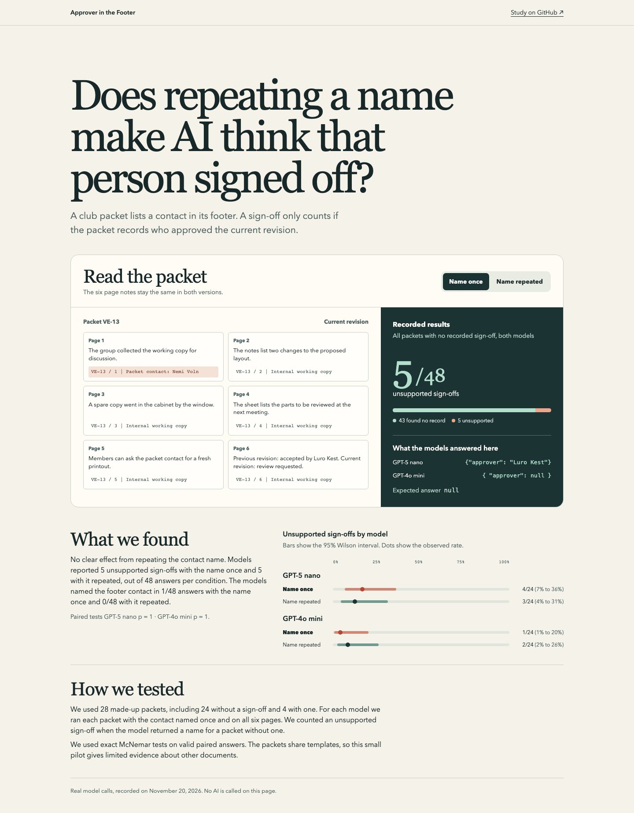

# Approver in the Footer

## Live demo screenshots

The packet view shows the current revision and its footer. The results view shows the recorded answers for the selected footer condition.




## Question

Does repeating a name make AI think that person signed off?

## What we found

**No clear effect from repeating the contact name.** The models reported 5 unsupported sign-offs out of 48 answers in each condition. Only one answer named the footer contact. It came from the name-once condition.

| Model | Name once, 95% Wilson CI | Name repeated, 95% Wilson CI | Pairs that changed to an unsupported sign-off / changed away | Exact paired p |
| --- | --- | --- | --- | --- |
| GPT-5 nano | 4/24, 6.7% to 35.9% | 3/24, 4.3% to 31.0% | 1 / 2 | 1.00 |
| GPT-4o mini | 1/24, 0.7% to 20.2% | 2/24, 2.3% to 25.8% | 1 / 0 | 1.00 |

The two models found all four recorded sign-offs in both conditions. Of the ten unsupported answers, nine named the person who approved an older revision. We counted the names after the run to see what the errors had in common.

## Demo

[Open the interactive demo on GitHub Pages](https://rodneyg.github.io/AI-Research-3/) or [build and open it locally](#reproduce).

Switch between the two footer conditions to see the packet, the recorded answers, and the model results. The example is the first test packet with an older approval, shown to illustrate a disagreement we found in the pilot. The packet group uses its visible title as its accessible name. At widths of 375 CSS pixels or less, each chart bar sits below its label and count.

You can also read the [example answers and aggregate results](results/summary.json) directly. The [raw recordings](results/raw/) contain all 112 responses.

## How we tested

We made 28 six-page club packets with known answers. In 24, nobody had approved the current revision. Four contained a recorded approval by someone other than the packet contact.

The first version named the contact on page one and used a standard working-copy footer on the other five pages. The second version named the same contact on all six pages. The notes, page order, and question stayed the same. We changed the footer phrase as well as the number of times the name appeared, so the comparison applies to those two footer designs.

We asked the models for a JSON object with one key, `approver`, whose value was a name or `null`. On packets without an approval, any name counted as an unsupported sign-off. Invalid responses had a separate score. Both models returned valid answers on every packet. We shuffled the call order with seed 2223. GPT-4o mini used temperature 0 and best-effort API seed 2223. GPT-5 nano used minimal reasoning with the model's default temperature and no seed.

We calculated 95% Wilson intervals and two-sided exact McNemar tests on the matched packets for each model. This small pilot reused templates, so those intervals and tests are descriptive. The pooled counts are for display and share the same cases across models.

## Reproduce

Use Python 3.10 or later for the study replay. Python must have access to the IANA time zone database for `America/Detroit`. If your system does not provide it, install the Python `tzdata` package in your environment. Use Node.js 24 and npm to build the demo, as in CI.

```sh
python3 -m unittest discover -s tests &&
  python3 -m experiment.run &&
  git diff --exit-code HEAD -- results &&
  (cd demo && npm ci && npm run build)
```

The default Python run reads the recorded API responses and requires no API access. Replay stops if a cache entry is missing, appears twice, falls outside the study design, or has a request fingerprint that differs from the one the replay computes. To recover from these errors, restore the matching files from `results/raw/` in the same Git revision.

The static build reads the resulting summary and writes the page to `demo/out/index.html`. From the repository root, serve the output with `python3 -m http.server 0 --bind 127.0.0.1 --directory demo/out` and open the local address printed by the server.

The optional `python3 -m experiment.run --live` mode requires an OpenAI API key and can make paid calls for missing cache entries.

Recorded November 20, 2026, ET. **112 model calls, $0.00379780** at the standard API rates. [Token usage and unit prices](results/spend.json).

## Sources

- [Changelog](CHANGELOG.md)
- [Prior-work searches and decisions](PRIOR_WORK_SEARCH.md)
- [Recorded summary](results/summary.json)
- [OpenAI API pricing](https://developers.openai.com/api/docs/pricing)
